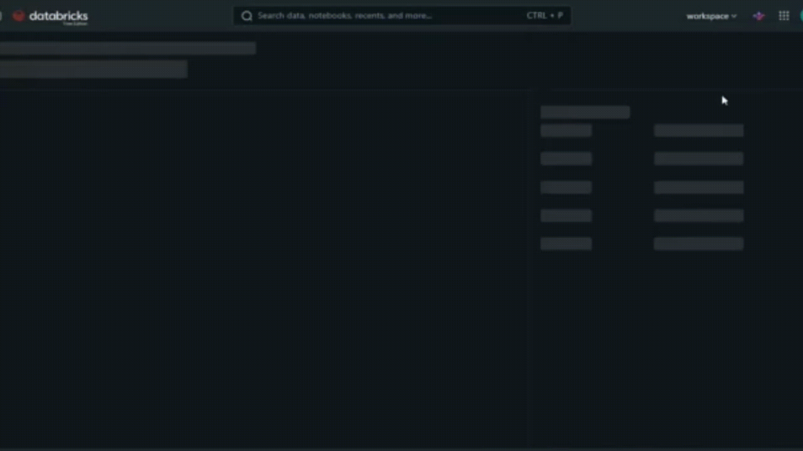
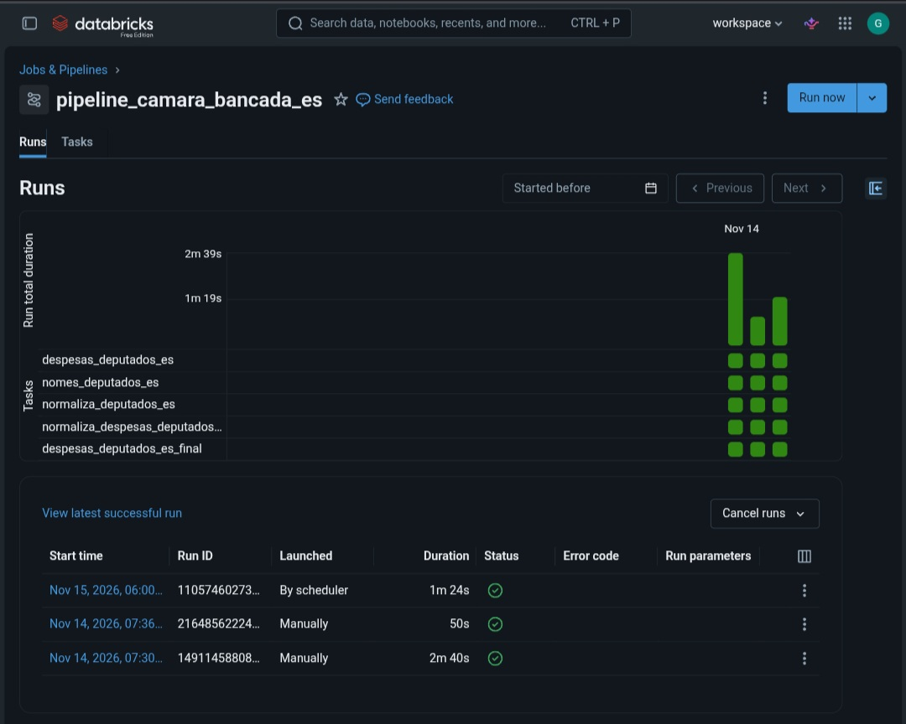

# 🏛️ Pipeline Câmara dos Deputados: Bancada do Espírito Santo

[](https://databricks.com/)
[](https://www.python.org/)
[](https://delta.io/)
[](https://www.postgresql.org/)

Pipeline de engenharia de dados end-to-end desenvolvido no **Databricks**, responsável por coletar, tratar, auditar e consolidar os dados cadastrais e os gastos de cota parlamentar dos deputados federais do Espírito Santo, utilizando a API de Dados Abertos da Câmara dos Deputados.

> **Pergunta central que o projeto responde:** quanto cada deputado federal capixaba gasta, com o quê e qual o perfil de execução orçamentária da bancada?

---

## 📊 Demonstração do Pipeline


---

## 🏗️ Arquitetura do Lakehouse (Medallion Architecture)
Os dados são estruturados e governados no **Unity Catalog** sob o schema `dados_es`:

| Camada | Schema | Descrição |
|--------|--------|-----------|
| **Bronze** | `dados_es.bronze` | Ingestão bruta (*raw*), espelhando exatamente os payloads JSON obtidos via API. |
| **Silver** | `dados_es.silver` | Dados limpos, tipados e normalizados (`deputados_clean` e `despesas_clean`), com deduplicação e saneamento de valores. |
| **Gold** | `dados_es.gold` | Tabela analítica relacional consolidada (`resumo_despesas_deputado`), pronta para consumo em BI. |

---

## ⚙️ Orquestração (Databricks Jobs)
O pipeline é totalmente automatizado por meio de um Job orquestrado no Databricks (`pipeline_camara_bancada_es`), composto por 5 tasks sequenciais:

| Task no Job | Notebook Correspondente | Responsabilidade |
|-------------|-------------------------|------------------|
| `nomes_deputados_es` | `01_deputados_extract_api_camara.py` | Extração da lista oficial de deputados da bancada. |
| `despesas_deputados_es` | `02_despesas_extract_lote.py` | Ingestão paginada em lote de todas as despesas (2023–2026). |
| `normaliza_deputados_es` | `03_silver_transform_deputados.py` | Limpeza cadastral e tipagem em PySpark. |
| `normaliza_despesas_deputados_es` | `04_silver_transform_despesas.py` | Tratamento financeiro, conversão de datas e deduplicação. |
| `despesas_deputados_es_final` | `05_gold_analytics_despesas.py` | Modelagem dimensional e agregações em Spark SQL. |



---

## 💡 Decisões de Engenharia e Regras de Negócio

1. **Paginação Resiliente de APIs:** Implementação de controle manual de páginas com tratamento de erros HTTP e mitigação de bugs de parâmetros combinados da API da Câmara.
2. **Saneamento do `valor_liquido`:** Na API de cota parlamentar, lançamentos de despesas vêm com sinal negativo na coluna líquida, enquanto estornos vêm positivos. Na camada Gold, aplicamos uma transformação contábil para exibir os gastos reais como valores positivos (facilitando somas e visualizações em gráficos) e mantendo os estornos como redutores.
3. **Deduplicação Inteligente:** A deduplicação na Silver utiliza uma chave composta (`deputado_id`, `documento_id`, `valor_liquido`) para evitar a exclusão acidental de estornos que compartilham o mesmo código de documento fiscal.

---

## 📂 Estrutura do Repositório

```text
├── docs/        # Prints de execução, GIFs e recursos visuais
├── jobs/        # Definição exportada do Job do Databricks (JSON)
└── notebooks/   # Notebooks do pipeline numerados por ordem de execução
